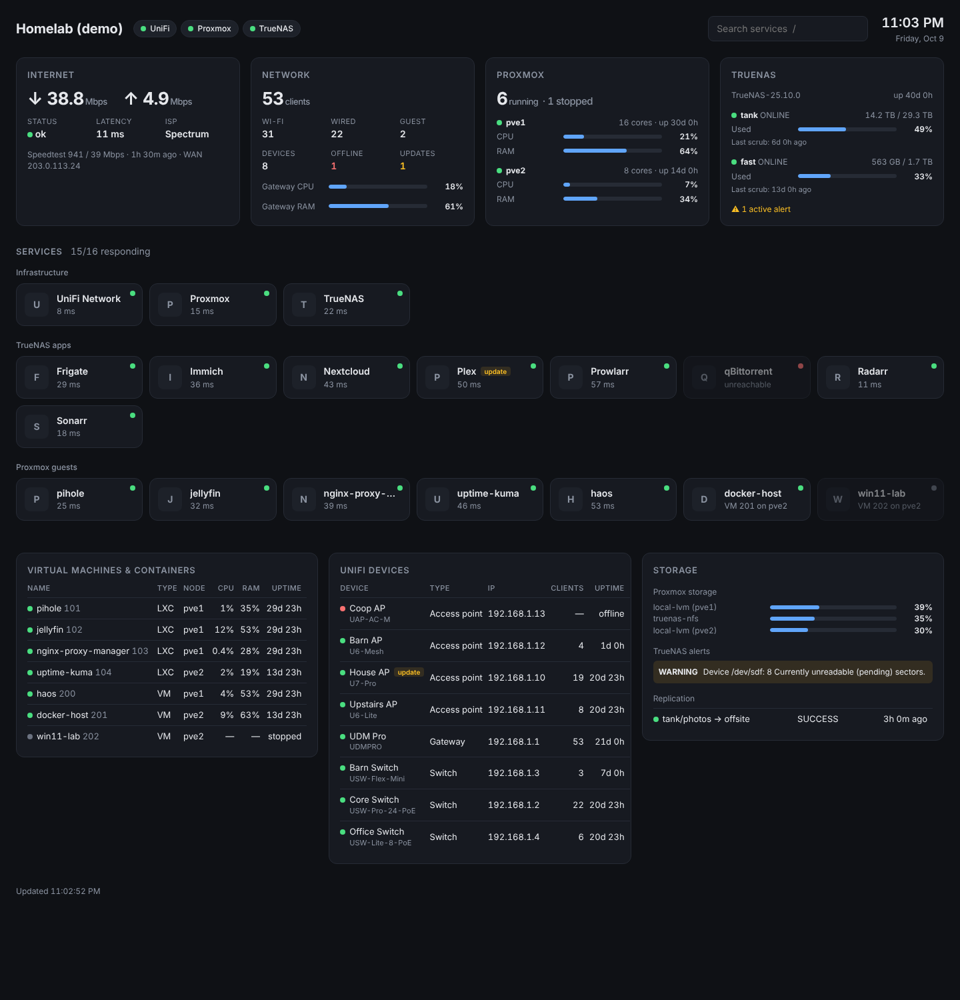

# Homelab Dashboard

A self-hosted infrastructure dashboard in the spirit of Homarr, for a UniFi + Proxmox + TrueNAS lab.
It runs on your network, polls each system's API with read-only credentials, and serves a single
auto-refreshing page.



**What it shows**

| Source | Widgets |
|---|---|
| UniFi (UDM Pro) | WAN status, live throughput, latency, last speedtest, client counts, gateway CPU/RAM, every UniFi device with online state, clients and firmware updates |
| Proxmox VE | Node CPU/RAM/uptime, every VM and LXC with status and usage, storage capacity |
| TrueNAS | Pool health and usable capacity, last scrub, active alerts (warning and above), replication tasks, installed apps |
| Services | A tile per service with an HTTP up/down check and response time, grouped and searchable (press `/`) |

**Service discovery.** You don't need to list everything by hand:

- Every installed **TrueNAS app** becomes a tile linked to its web UI.
- Every **Proxmox VM/LXC** becomes a tile. If its name matches a known app (Jellyfin, Pi-hole,
  Home Assistant, Nginx Proxy Manager and about 70 others, see `app/catalog.py`), the dashboard
  looks up the guest's IP and links to the app's default port.
- Anything else goes in `services:` in the config. Configured tiles replace discovered ones with
  the same name or URL.

Icons come from [dashboard-icons](https://github.com/homarr-labs/dashboard-icons) via jsDelivr.
When the browser can't reach the CDN, tiles fall back to letter avatars.

## Quick start

```bash
git clone <this repo> homelab-dashboard && cd homelab-dashboard
cp config/config.example.yaml config/config.yaml
cp .env.example .env && chmod 600 .env
# edit config/config.yaml (IPs) and .env (secrets), then:
docker compose up -d --build
```

Open `http://<host>:8080`. To preview without credentials, set `DASHBOARD_DEMO: "1"` in
`docker-compose.yml`.

A small Debian LXC on Proxmox (1 vCPU, 512 MB) with Docker works well. You can also run it as a
custom app on TrueNAS.

Without Docker:

```bash
python3 -m venv .venv && .venv/bin/pip install -r requirements.txt
DASHBOARD_CONFIG=config/config.yaml .venv/bin/uvicorn app.main:app --host 0.0.0.0 --port 8080
```

## Read-only credentials

Give the dashboard credentials that can read and nothing else.

### UniFi (UDM Pro)

**Option A: API key** (UniFi Network 9.0 or later). In the Network app, go to
**Settings → Control Plane → Integrations**, create an API key and put it in `UNIFI_API_KEY`.

**Option B: local view-only admin** (use this if the API key returns 401 on your firmware).
In **UniFi OS → Admins & Users**, add a user, choose **Restrict to local access only**, and give it
the **View Only** role for Network and **None** for other apps. Then set `username` and `password`
in the config instead of `api_key`. Accounts with MFA can't be used here.

### Proxmox VE

Run this on any node:

```bash
pveum user add dashboard@pve --comment "Homelab dashboard (read-only)"
pveum acl modify / --users dashboard@pve --roles PVEAuditor
pveum user token add dashboard@pve homelab --privsep 1
pveum acl modify / --tokens 'dashboard@pve!homelab' --roles PVEAuditor
```

Put the printed secret in `PVE_TOKEN_SECRET`. `PVEAuditor` covers nodes, guests, storage and
**LXC** IP lookup.

VM IP lookup also needs the QEMU guest agent running in the VM, plus one extra privilege. Skip it
if you don't need links for VM tiles.

```bash
# PVE 9:
pveum role add DashboardAgent --privs "VM.GuestAgent.Audit"
# PVE 8:
pveum role add DashboardAgent --privs "VM.Monitor"

pveum acl modify /vms --users dashboard@pve --roles DashboardAgent
pveum acl modify /vms --tokens 'dashboard@pve!homelab' --roles DashboardAgent
```

### TrueNAS

1. In **Credentials → Users**, add a user `dashboard` with no shell and no SMB access. Give it the
   **Read-only Administrator** role (the field is called *Roles* or *Privileges*, depending on
   version).
2. Sign in as that user (or as admin, using **API Keys → Add** with the user set to `dashboard`)
   and create an API key. Put it in `TRUENAS_API_KEY`.
3. TrueNAS 25.04 and later use the websocket JSON-RPC API (the default). On 24.x, set `api: rest`.

## Security notes

- The dashboard has **no login of its own** and shows your network layout. Keep it on the LAN or a
  management VLAN, or put it behind your reverse proxy with SSO (Authentik, Authelia, or Cloudflare
  Access if exposed).
- Secrets stay on the server. The browser only receives the summarized state from `/api/state`.
- `verify_ssl: false` is the default because home lab gear usually has self-signed certificates.
  Turn it on per integration if you've installed real certificates.

## Development

```bash
python3 -m venv .venv && .venv/bin/pip install -r requirements-dev.txt
.venv/bin/pytest -q
DASHBOARD_DEMO=1 .venv/bin/uvicorn app.main:app --reload --port 8080
```

Layout:

- `app/integrations/`: one module per system. Each has a pure `parse()` and an async `fetch()`.
- `app/services.py`: tile discovery and merging.
- `app/static/`: the front end, plain HTML/CSS/JS with no build step.

Adding a widget means writing a `parse`/`fetch` pair, registering a poller in `app/main.py`, and
adding a render function in `app.js`.
